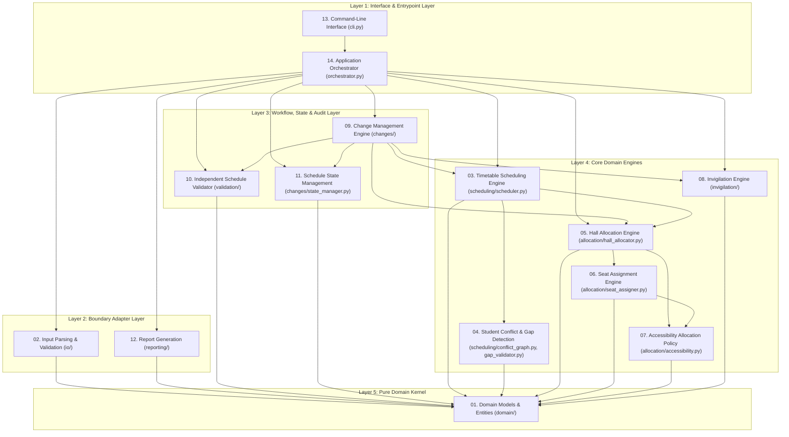

# 07 — System Architecture

**Document Status:** Week 1 Design Baseline — Pending Team Confirmation & Mentor Approval  
**Related Diagrams:** [`diagrams/01_system_context.mmd`](diagrams/01_system_context.mmd), [`diagrams/02_component_architecture.mmd`](diagrams/02_component_architecture.mmd)  
**Related Documents:** [`08_DOMAIN_MODEL.md`](08_DOMAIN_MODEL.md), [`11_INCREMENTAL_RECOMPUTATION.md`](11_INCREMENTAL_RECOMPUTATION.md), [`12_MODULE_OWNERSHIP.md`](12_MODULE_OWNERSHIP.md), [`16_DECISION_LOG.md`](16_DECISION_LOG.md)

---

## 1. Architectural Style & Guiding Principles

The system adopts a **Modular Layered In-Memory Engine Architecture** driven via CLI and file adapters, adhering strictly to Python 3.10+ standard-library primitives (`ADR-001`, `ADR-002`):

1. **Strict Unidirectional Layering:** Presentation/CLI and File I/O adapters depend inward on Application Orchestration and Pure Domain Engines; Domain Models have **zero** dependencies on I/O, CLI, or engine algorithms.
2. **Constructive + Independent Audit Dualism (`ADR-011`):** Scheduling, Allocation, and Invigilation engines *construct* valid assignments, while a completely separate **Independent Schedule Validator** *audits* every committed `ScheduleState` against `BR-01`–`BR-12` from first principles.
3. **Policy Isolation without Configuration Sprawl:** Ambiguous boundary policies (`AS-001`–`AS-033`) are encapsulated in cohesive policy functions/classes (`allocation/policies.py`, `invigilation/eligibility.py`, `changes/policies.py`) rather than polluting CLI arguments or scattering magic numbers across loops.
4. **Copy-on-Write Transactional State (`ADR-009`):** Incremental change commands execute against an isolated candidate snapshot of `ScheduleState`, verifying both global invariants and **unaffected-session hash equality** before atomic promotion.
5. **Deterministic Execution by Construction (`ADR-010`):** Every collection crossing module boundaries is an ordered `tuple` or sorted `list`/`dict` iterated via explicit sort keys; `random`, wall-clock timestamps inside domain outputs, and unordered `set` iteration are prohibited.

---

## 2. Layered Component Architecture (14 Required Components)

---

## 3. Detailed Specification of the 14 Components

| # | Component Name | Planned Package / Module | Primary Responsibilities | Owned Rules / Algorithms | Proposed Owner |
| :---: | :--- | :--- | :--- | :--- | :--- |
| **1** | **Domain Models** | `src/exam_engine/domain/` | Immutable input entities (`Course`, `Student`, `Enrolment`, `Building`, `Hall`, `Invigilator`, `ExamWindow`, `ExamSession`), generated assignment records, enums, and `ScheduleState` container. | Entity invariants (`08_DOMAIN_MODEL.md`) | Shared (Mishael lead) |
| **2** | **Input Parsing & Validation** | `src/exam_engine/io/` | Reads provisional CSV/JSON files, normalises identifiers/booleans/dates, checks referential integrity (`CN-01`–`CN-06`), builds `ProblemInstance` & `ChangeCommand` list. | `FR-01`, `FR-02`, `ALG-01` | Mishael (with Steven/Tanisha schema hooks) |
| **3** | **Timetable Scheduling Engine** | `src/exam_engine/scheduling/` (`ordering.py`, `session_generator.py`, `supplementary.py`, `scheduler.py`) | Generates `ExamSession` timeline, sorts courses (`BR-03`), checks `BR-12` supplementary windows & `BR-04` 90% session cap, invokes trial hall packability (`ALG-08`), executes two-pass greedy assignment + small-course merge repair. | `BR-03`, `BR-04` (session), `BR-12`; `ALG-02`, `ALG-05`–`ALG-07` | Steven Mathew Binu |
| **4** | **Student Conflict Detection** | `src/exam_engine/scheduling/` (`conflict_graph.py`, `gap_validator.py`) | Precomputes student overlap conflict graph (distinguishing regular clashes vs `BACKLOG_CONSENT` pairs) and validates `BR-02` programme-semester core-course calendar gaps. | `BR-01`, `BR-02`; `ALG-03`, `ALG-04` | Steven Mathew Binu |
| **5** | **Hall Allocation Engine** | `src/exam_engine/allocation/` (`hall_allocator.py`, `merge_policy.py`) | Packs session courses into available halls largest-first (`(-capacity, hall_id)`), enforces duration homogeneity (`2h` vs `3h`), max 2 courses/hall, and mandatory `< 10` cross-department merging. | `BR-04` (hall), `BR-05`; `ALG-08`–`ALG-10` | Tanisha Chhetri |
| **6** | **Seat Assignment Engine** | `src/exam_engine/allocation/seat_assigner.py` | Partitions columns into odd Set A and even Set B, generates row-major coordinates (`R01C01`), seats students alphabetically by `register_number` within their course's column set without exceeding declared `capacity`. | `BR-05` (columns), `BR-06` (seating); `ALG-11` | Tanisha Chhetri |
| **7** | **Accessibility Allocation Policy** | `src/exam_engine/allocation/accessibility.py` | Reserves ground-floor (`floor == 0`) halls for courses with `special_needs` students, places `special_needs` students in `row == 1` alphabetically, and extends hall `effective_end_time` by `+20` minutes. | `BR-06` (accessibility & +20m); `ALG-12` | Tanisha Chhetri |
| **8** | **Invigilation Engine** | `src/exam_engine/invigilation/` (`eligibility.py`, `workload.py`, `invigilator_engine.py`) | Computes `ceil(n/30)` hall invigilators + `1` Chief per active building, filters department (`EC-04`), unavailable date, extended-time overlap (`EC-05`), daily (`<= 2`) & ISO-weekly (`4–8`) caps, sorts by `(assigned_so_far, dept, id)`, flags `UNSTAFFED`. | `BR-07`, `BR-08`; `ALG-13`, `ALG-14` | Mishael Julian |
| **9** | **Change Management Engine** | `src/exam_engine/changes/` (`postponement.py`, `hall_unavailability.py`, `late_registration.py`) | Executes `POSTPONE_COURSE`, `MARK_HALL_UNAVAILABLE`, and `ADD_LATE_REGISTRANT` strictly inside affected sessions, computing minimal delta updates or smallest-course displacements. | `BR-09`, `BR-10`, `BR-11`; `ALG-15`–`ALG-17` | Tanisha Chhetri |
| **10** | **Independent Schedule Validator** | `src/exam_engine/validation/validator.py` | Stateless audit engine verifying `CN-07` through `CN-28` across an entire `ScheduleState` and verifying blast-radius preservation across pre/post states. | All `BR-01`–`BR-12`; `ALG-18` | Mishael Julian |
| **11** | **Schedule State Management** | `src/exam_engine/changes/state_manager.py` | Manages immutable session snapshots, candidate state cloning, per-session structural fingerprints (SHA-256 canonical digests), atomic commit, and rollback on failure. | `FR-05`, `NFR-03`; `ALG-19` | Tanisha & Mishael (shared interface) |
| **12** | **Report Generation** | `src/exam_engine/reporting/` | Pure formatters transforming `ScheduleState` and `ChangeResult` logs into deterministically sorted `CSV`, `JSON`, and ASCII `seat_maps.txt` artefacts. | `FR-06`; `ALG-20` | Mishael Julian |
| **13** | **Command-Line Interface** | `src/exam_engine/cli.py` | Parses CLI flags (`--input-dir`, `--commands`, `--output-dir`, `--strict-audit`), maps exceptions to exit codes (`0` = success, `2` = invalid input, `3` = internal invariant error), prints concise execution summary. | CLI entrypoint | Mishael Julian |
| **14** | **Application Orchestrator** | `src/exam_engine/orchestrator.py` | Coordinates the full lifecycle: Parse -> Build Sessions -> Schedule -> Allocate Halls & Seats -> Staff Invigilators -> Validate Initial State -> Emit Initial Reports -> Loop Change Commands -> Emit Final Reports. | End-to-end workflow | Mishael Julian |

---

## 4. End-to-End Execution Pipeline

1. **Bootstrap (`cli.py` -> `orchestrator.py`):** CLI resolves file paths and invokes `ExamEngineOrchestrator.run(input_dir, output_dir, commands_path)`.
2. **Ingestion & Normalisation (`io/`):** Parses CSV/JSON inputs into an immutable `ProblemInstance` (`ALG-01`). Any `CN-01`–`CN-06` violation aborts immediately with exit code `2`.
3. **Timeline & Conflict Precomputation (`scheduling/`):**
   - `ALG-02` expands `ExamWindow` into chronologically indexed `ExamSession`s (`0 .. M-1`) and identifies the final 3 active exam dates (`BR-12`).
   - `ALG-03` builds the immutable `ConflictGraph` over courses (`O(N_students * avg_courses^2)`).
   - `ALG-05` sorts courses deterministically (`BR-03`).
4. **Initial Synthesis (`scheduling/` -> `allocation/` -> `invigilation/`):**
   - `ALG-06` places each course into its earliest feasible session (checking `ALG-03` clashes, `ALG-04` core gaps, `ALG-07` supplementary window, `BR-04` 90% session cap, and `ALG-08` physical hall/merge/accessibility packability), recording `CORE_GAP_SOFT_VIOLATION` on Pass-2 fallback or `UNSCHEDULED` if infeasible.
   - For every active session (`0 .. M-1`), `ALG-09`–`ALG-12` materialise `HallAllocation`s and `SeatAssignment`s.
   - Across chronological sessions (`0 .. M-1`), `ALG-13`–`ALG-14` materialise hall `InvigilationAssignment`s and `BUILDING_CHIEF` assignments (or `UNSTAFFED` violations).
5. **Independent Initial Audit (`validation/`):** `ALG-18` validates the synthesised `ScheduleState` (`version = 0`). If initial outputs are requested, `ALG-20` writes `output/initial/` (or root `output/` if no commands exist).
6. **Transactional Incremental Loop (`changes/` -> `validation/`):**
   - For each `ChangeCommand` $k = 1 \dots K$:
     - `ALG-19` clones `candidate_state` and records per-session fingerprints for all sessions.
     - `ALG-15` (`POSTPONE_COURSE`), `ALG-16` (`MARK_HALL_UNAVAILABLE`), or `ALG-17` (`ADD_LATE_REGISTRANT`) mutates **only** `affected_sessions` on `candidate_state`.
     - `ALG-18` validates `candidate_state` globally AND `ALG-19` verifies fingerprint equality for every `session_id not in affected_sessions`.
     - On pass: `candidate_state` becomes active `state` (`version = k`), `ChangeResult(status=APPLIED)` recorded.
     - On rejection: `candidate_state` discarded, previous `state` retained intact, `ChangeResult(status=REJECTED_*)` recorded.
7. **Final Reporting (`reporting/`):** `ALG-20` emits deterministic `timetable.csv`, `hall_plan.csv`, `seat_assignments.csv`, `seat_maps.txt`, `invigilation_roster.csv`, `violations.json`, `schedule_state.json`, and `change_results.json`.

---

## 5. Cross-Module Dependency Rules & Interface Contracts

To allow Steven, Tanisha, and Mishael to code in parallel during Weeks 2 and 3 without merge conflicts:

- **Forbidden Cyclic Imports:**
  - `domain/` imports **nothing** from `exam_engine.*`.
  - `allocation/` never imports `scheduling/` or `invigilation/`; instead, `scheduling/scheduler.py` calls a clean stateless protocol `HallPackabilityChecker.check_and_pack_session(session, courses, available_halls) -> SessionPackingResult` provided by `allocation/`.
  - `invigilation/` reads `HallAllocation` objects from `ScheduleState` and never mutates courses or seats.
  - `validation/` imports **only** `domain/` (never calling helper functions from `scheduling/`, `allocation/`, or `invigilation/`, preventing shared-bug blind spots!).

---

## 6. Determinism & Technology Stack Summary

- **Proposed Language:** Python 3.10+ (*Pending Team Confirmation* — chosen for `dataclasses(frozen=True, slots=True)`, structural pattern matching, union type syntax `X | Y`, and rich standard library).
- **Determinism Enforcement Rules:**
  1. Never iterate over a raw `set` (`for x in my_set:` is banned by code review; always `for x in sorted(my_set):`).
  2. Every `sort()` / `sorted()` call ends its key tuple with the entity's unique string primary key (`course_code`, `register_number`, `hall_id`, `building_code`, `invigilator_id`).
  3. Use integer math `(90 * total_cap) // 100` and `(occupied + 29) // 30` instead of floating-point division.
  4. Verify determinism in CI/pytest by running with `PYTHONHASHSEED=1` vs `PYTHONHASHSEED=42` and asserting SHA-256 equality of all output files.
