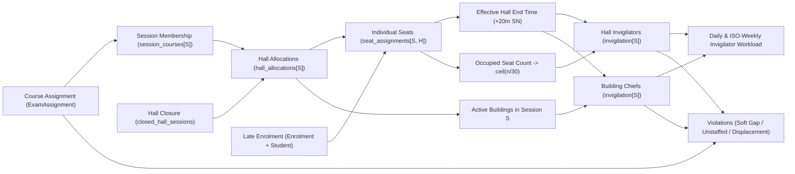

# 11 — Incremental Recomputation Design

**Document Status:** Week 1 Design Baseline — First-Class Architectural Feature  
**Related Diagrams:** [`diagrams/05_change_command_state_diagram.mmd`](diagrams/05_change_command_state_diagram.mmd), [`diagrams/09_course_postponement_sequence.mmd`](diagrams/09_course_postponement_sequence.mmd), [`diagrams/10_hall_unavailability_sequence.mmd`](diagrams/10_hall_unavailability_sequence.mmd), [`diagrams/11_late_registration_sequence.mmd`](diagrams/11_late_registration_sequence.mmd), [`diagrams/12_incremental_recomputation_dependency.mmd`](diagrams/12_incremental_recomputation_dependency.mmd)  
**Related Documents:** [`04_BUSINESS_RULE_REGISTER.md`](04_BUSINESS_RULE_REGISTER.md), [`08_DOMAIN_MODEL.md`](08_DOMAIN_MODEL.md), [`09_ALGORITHM_DESIGN.md`](09_ALGORITHM_DESIGN.md)

---

## 1. Architectural Mandate: Zero Full-System Regeneration

Under `FR-05` and `BR-09`–`BR-11`, once an examination timetable and hall/invigilation plan have been published, operational disruptions must **never** trigger a global from-scratch reschedule. Students, departments, and invigilators outside the impacted session(s) rely on their published assignments remaining frozen.

Accordingly, our architecture enforces **two simultaneous guarantees**:
1. **Strict Local Mutation (Blast-Radius Isolation):** Only sessions inside the command's computed `affected_sessions` set may have their hall plans, seats, or invigilators modified.
2. **Global Read-Only Constraint Integrity:** Cross-session constraints—student daily limits (`BR-01`), programme-semester core gaps (`BR-02`), and invigilator daily/weekly session caps (`BR-07`)—are **inspected** across all fixed (unaffected) sessions without mutating any unaffected session.

---

## 2. State Dependency Directed Acyclic Graph (DAG)

### Dependency Propagation Rules
- **Session-Local Edges (`SM -> HA -> SA -> IA -> BC`):** Partitioned strictly by `session_id`. Changing `session_courses[S]` invalidates `HA[S]`, `SA[S]`, `IA[S]`, and `BC[S]` for session `S` **only**—never for `S' != S`.
- **Cross-Session Read-Only Couplings:**
  1. `ExamAssignment` changes in `S_dest` read `session_courses[S_sibling]` on the same date (`BR-01`) and `ExamAssignment` dates of cohort core courses (`BR-02`).
  2. `IA[S]` and `BC[S]` read fixed `InvigilationAssignment`s on `S.exam_date` (`daily_count <= 2`) and across `S.iso_week_key` (`weekly_count <= max_weekly_sessions`) plus global `total_assigned` (`BR-08`).

---

## 3. Fixed Invigilator Workload Accounting Across Unaffected Sessions

A critical subtlety during incremental recomputation (`BR-09`, `BR-10`, `BR-11`) is how `BR-07` and `BR-08` account for invigilation duties in unaffected sessions (including sessions chronologically *after* the affected session!):

1. **Pre-Staffing Stripping:** Suppose `affected_sessions = {S_orig, S_dest}`. On `candidate_state`, we clear `invigilation_assignments[S_orig]` and `invigilation_assignments[S_dest]`.
2. **Fixed Baseline Reconstruction:** `WorkloadTracker.from_fixed_sessions(candidate_state, exclude=affected_sessions)` scans all `S_fixed not in affected_sessions` and tallies for every invigilator $v$:
   - `fixed_total[v]` = total `ASSIGNED` duties (hall + chief) across all unaffected sessions.
   - `fixed_daily[v, d]` = `ASSIGNED` duties in any unaffected session on date `d` (e.g., if `2026-12-04_FN` is unaffected and `2026-12-04_AN` is `S_dest`, an invigilator working `FN` starts `AN` staffing with `daily_count = 1`).
   - `fixed_weekly[v, iso_week]` = `ASSIGNED` duties across all unaffected sessions in that Monday–Sunday ISO week.
3. **Chronological Local Re-Staffing:** Affected sessions are sorted chronologically (`session_index` ascending) and staffed via `ALG-13` + `ALG-14` on top of `WorkloadTracker`. Because `WorkloadTracker` already includes `fixed_weekly[v, iso_week]` from later days of the same week, selecting $v$ for `S_dest` can **never** push $v$ above `v.max_weekly_sessions` (`4..8`) or above `2` duties/day!

---

## 4. Per-Command Incremental Lifecycle Specifications

Every `ChangeCommand` passes through an identical **8-stage transactional protocol**:

| Stage | Responsibility |
| :--- | :--- |
| **1. Initial Command Validation** | Verify target `course_code` / `hall_id` / `session_id`s exist and command payload satisfies schema invariants. |
| **2. Candidate Snapshot & Pre-Digests** | Clone `ScheduleState` (`copy-on-write` per-session tuples) and compute SHA-256 canonical digests `D_before[S]` for every session `S`. |
| **3. Affected-Session Identification** | Compute exact minimal `affected_sessions` set (dynamically extended only if `BR-10` displaces a course). |
| **4. Local Recomputation** | Regenerate allocations **only** for `affected_sessions` (or single hall-course column set + delta staff for `BR-11`). |
| **5. Cross-Session Constraint Validation** | Run `ALG-18` (`IndependentScheduleValidator`) across the entire `candidate_state`. |
| **6. Unaffected-State Preservation Check** | Assert `D_before[S] == D_after[S]` for **every** `S not in affected_sessions`. |
| **7. Commit or Rollback** | Promote `candidate_state` (`version + 1`) iff Stages 4–6 succeed; else discard `candidate_state` and retain `prev_state` intact. |
| **8. Audit Logging** | Append immutable `ChangeResult` to `change_history`. |

---

### 4.1 `POSTPONE_COURSE` (`BR-09` — `ALG-15`)
- **Initial Validation:** `course_code` exists and is currently scheduled in `S_orig` (cannot postpone an `UNSCHEDULED` course or a course already in the final session of the window).
- **Affected Sessions:** Strictly `{S_orig, S_dest}` (`|affected_sessions| == 2`).
- **Local Recomputation:**
  1. Remove `course_code` from `S_orig`; verify remaining courses in `S_orig` still pack legally via `ALG-08` (guards against stranding a `< 10` small partner in `S_orig` without a valid cross-department partner).
  2. Scan sessions `S.session_index > S_orig.session_index` using `BR-03` two-pass feasibility (`hard + gap`, then `hard + SOFT_VIOLATION` per `AS-027`), checking `BR-01` daily limits against fixed courses on `S.exam_date`.
  3. Run `ALG-09`–`ALG-14` **only** on `S_orig` and `S_dest` (removing stale violations tied to `S_orig` / `course_code` and attaching updated violations for `{S_orig, S_dest}`).
- **Commit / Rollback:** Commits iff `S_dest` found, `S_orig` remains hard-valid, `ALG-18` passes, and all $M - 2$ other sessions match their SHA-256 pre-digests; otherwise rolls back with `REJECTED_NO_FEASIBLE_SESSION`.

---

### 4.2 `MARK_HALL_UNAVAILABLE` (`BR-10` — `ALG-16`)
- **Initial Validation:** `hall_id` exists in `registry.halls`; `target_session_ids` exist in `registry.sessions`.
- **Affected Sessions:**
  - `0` sessions mutated (beyond recording `(S, hall_id)` in `closed_hall_sessions`) if `hall_id` was unoccupied in `target_session_ids`!
  - `{S_orig}` if displaced students fit into remaining halls of `S_orig` (next largest available compatible hall first).
  - `{S_orig, S_dest_1, ...}` if aggregate 90% session cap or physical hall capacity in `S_orig` is insufficient, forcing `S_orig`'s smallest course(s) `(enrolment_count, credits, course_code)` to move to the next free strictly later session `S_dest_i` (flagged `COURSE_DISPLACED_BY_HALL_CLOSURE`).
- **Local Recomputation:** Run `ALG-09`–`ALG-14` solely on `affected_sessions` (sorted chronologically).
- **Commit / Rollback:** Commits iff all impacted `S_orig` and `S_dest_i` pack legally and pass `ALG-18`; rolls back with `REJECTED_HALL_CLOSURE_INFEASIBLE` if a displaced course has zero feasible later sessions (e.g., closure on the very last session leaving `0` halls).

---

### 4.3 `ADD_LATE_REGISTRANT` (`BR-11` — `ALG-17`)
- **Initial Validation:** Student fields valid (`CN-02`); every target `course_code` exists, is scheduled, and is not already enrolled by this student.
- **Clash Check (`BR-01`):** Evaluate all pairs among `(existing_enrolments U new_enrolments)` for this student. Any same-session pair or unconsented same-day pair immediately aborts and rolls back with `REJECTED_CLASH` + `conflicting_courses = (c_a, c_b)` (`sorted`).
- **Affected Sessions & Intra-Session Minimalism:**
  - `affected_sessions` = `{session_of(c) for c in cmd.late_enrolments}`.
  - Even *inside* each affected session `S_c`, **other halls are NOT repacked**! Only the single selected hall `H*` (eligible hall with the most free legal seats for course `c`, `AS-028`) has course `c`'s column-set seats updated (`ALG-11`/`ALG-12`) and delta invigilation checked (`AS-029`: `+1` invigilator iff `ceil(n/30)` incremented or new hall opened; `+1` building chief iff `H*`'s building became newly active).
- **Atomicity (`AS-030`):** If a student registers late for 5 courses and course #4 fails (`REJECTED_SESSION_CAPACITY`, `REJECTED_HALL_CAPACITY`, or `REJECTED_ACCESSIBILITY_CAPACITY`), changes in sessions #1–#3 are discarded completely.

---

## 5. Verification of Unaffected-Assignment Preservation (`NFR-03`)

To prove mathematically and empirically during automated grading and viva demonstrations that unaffected sessions are untouched:

1. **Structural Immutability:** `ScheduleState` stores per-session assignments as immutable Python `tuple`s of frozen `@dataclass(frozen=True)` records (`hall_allocations[s_id]`, `seat_assignments[s_id]`, `invigilation_assignments[s_id]`). Cloning `ScheduleState` copies only the top-level `dict` references (`O(M)` shallow dict copy of immutable tuples!), making accidental mutation of an unaffected session structurally impossible without replacing its dictionary key.
2. **Cryptographic Digest Guard (`ALG-19`):** Before every command, `StateSnapshotManager` computes `D_before[s_id] = sha256(canonical_serialise(state, s_id))` for all $M$ sessions. Prior to commit, it asserts:
   $$\forall s \in \text{Sessions} \setminus \text{affected\_sessions}: \quad D_{\text{before}}[s] = D_{\text{after}}[s]$$
   Additionally, for `ADD_LATE_REGISTRANT`, an intra-session hall digest check asserts that within each `s in affected_sessions`, every `hall_id != target_hall_id` has identical seats and hall invigilators before and after!
