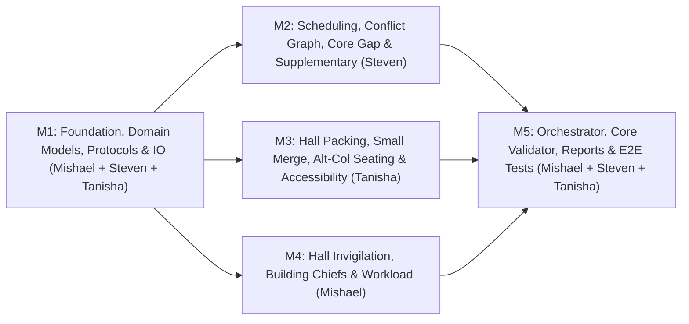

# 18 — Week 2 Implementation Plan (Handover Specification)

**Document Status:** Self-Contained Implementation Handover — **DO NOT EXECUTE UNTIL WEEK 1 MENTOR APPROVAL**  
**Week 2 Implementation Coordinator:** **Steven Mathew Binu (`2462157`)**  
**Contributing Engineers:** Steven Mathew Binu (`2462157`), Tanisha Chhetri (`2462160`), Mishael Julian (`2462184`)  
**Target Outcome:** Working end-to-end initial synthesis pipeline (`FR-01`–`FR-04`, `FR-06`) producing verified `timetable.csv`, `hall_plan.csv`, `seat_assignments.csv`, `seat_maps.txt`, `invigilation_roster.csv`, `violations.json`, and `schedule_state.json` with core unit & integration tests passing.

---

## 1. Self-Contained Context for Week 2 Setup

Any team member opening this repository in Week 2 can start immediately by reading:
1. [`04_BUSINESS_RULE_REGISTER.md`](04_BUSINESS_RULE_REGISTER.md) & [`05_ASSUMPTION_REGISTER.md`](05_ASSUMPTION_REGISTER.md) — Exact rules & boundary policies.
2. [`08_DOMAIN_MODEL.md`](08_DOMAIN_MODEL.md) — Exact dataclass fields, types, and invariants.
3. [`09_ALGORITHM_DESIGN.md`](09_ALGORITHM_DESIGN.md) — Pseudocode for `ALG-01`–`ALG-14`, `ALG-18` (core), and `ALG-20`.
4. [`10_INPUT_OUTPUT_CONTRACTS.md`](10_INPUT_OUTPUT_CONTRACTS.md) — Provisional CSV/JSON/TXT schemas.

### Branching & Git Hygiene Rules
- Branch off `main` (after Week 1 design PR is approved and merged) into `week2-dev`, with short-lived milestone branches: `feat/m1-foundation`, `feat/m2-scheduling`, `feat/m3-allocation`, `feat/m4-invigilation`, `feat/m5-integration`.
- **All three members** must commit their own modules and unit tests under their own Git author identity.
- Every PR requires `ruff check .` + `pytest` green + review by at least 1 teammate.

---

## 2. Parallel Execution Topology (`M1` -> `M2 || M3 || M4` -> `M5`)

> **How `M2`, `M3`, and `M4` Run in Parallel Immediately After `M1`:**
> `M1` defines `HallPackabilityChecker` protocol in `src/exam_engine/domain/protocols.py` along with a lightweight aggregate-90% stub for isolated `M2` unit tests. Thus **Steven (`M2`)**, **Tanisha (`M3`)**, and **Mishael (`M4`)** can develop and unit-test their respective packages simultaneously without waiting on one another, wiring the real `ALG-08` hall checker into `ALG-06` at the start of `M5`!

---

## 3. Detailed Milestone Specifications (`M1` – `M5`)

### Milestone M1 — Repository Foundation, Domain Entities, Protocols & Input Parsing
- **Objective:** Scaffold Python package structure, configure `pyproject.toml` (`python >= 3.10`, `pytest`, `ruff`), implement all 16 frozen domain models (`08_DOMAIN_MODEL.md`), shared protocols, input parsers/validators (`ALG-01`), and session generator (`ALG-02`).
- **Responsible Owner:** **Mishael Julian** (Domain, Protocols, `io/`) & **Steven Mathew Binu** (`session_generator.py`, repo config); reviewed by **Tanisha Chhetri**.
- **Dependencies:** Approved Week 1 design.
- **Files to Create:**
  - `pyproject.toml`, `.gitignore`
  - `src/exam_engine/__init__.py`
  - `src/exam_engine/domain/__init__.py`, `enums.py`, `entities.py`, `state.py`, `protocols.py`
  - `src/exam_engine/io/__init__.py`, `parsers.py`, `validators.py`
  - `src/exam_engine/scheduling/__init__.py`, `session_generator.py`
  - `tests/conftest.py` (`ScenarioBuilder` helper), `tests/unit/test_io_validation.py`, `tests/unit/test_session_generator.py`
- **Relevant Business Rules:** `FR-01`, `FR-02`, `CN-01`–`CN-06`, `EC-08`, `AS-003`, `AS-012`, `AS-015`, `AS-016`.
- **Implementation Requirements:**
  - Enforce `@dataclass(frozen=True, slots=True)` on all entities and `TimeInterval` minute-from-midnight value objects.
  - Ensure `ProblemRegistry` builds sorted `enrolments_by_course` and `enrolments_by_student` tuples as single source of truth.
  - Reject duplicate keys, unknown foreign keys, `duration_hours not in {2,3}`, `capacity > rows * columns`, `max_weekly_sessions not in 4..8`, and empty exam windows.
- **Required Tests:** `TC-001`–`TC-007`, `TC-099`–`TC-102` (11 unit tests).
- **Acceptance Criteria & DoD:** All 11 `M1` tests pass; `ruff check` passes; all 3 teammates review and merge `feat/m1-foundation` so parallel work begins on a locked `domain/` API.
- **Git Commit Boundaries:**
  1. `chore(build): configure pyproject.toml, ruff, pytest, and package skeleton`
  2. `feat(domain): implement frozen domain entities, enums, ScheduleState, and protocols`
  3. `feat(io): implement CSV/JSON parsers and ALG-01 input normalisation/validation`
  4. `feat(scheduling): implement ALG-02 exam session generator with holiday and slot closures`
  5. `test(m1): add ScenarioBuilder conftest and TC-001..007, TC-099..102 unit tests`
- **Handover to M2/M3/M4:** Locked `ProblemRegistry` and `HallPackabilityChecker` signature.

---

### Milestone M2 — Timetable Scheduling, Conflict Graph, Core Gap & Supplementary Engine
- **Objective:** Implement deterministic course ordering, student conflict graph, programme-semester core-gap check, supplementary window filter, and two-pass greedy scheduler (`ALG-03`–`ALG-07`).
- **Responsible Owner:** **Steven Mathew Binu (`2462157`)**.
- **Dependencies:** `M1` (`domain/`, `session_generator.py`). *(Runs in parallel with `M3` and `M4`!)*
- **Files to Create:**
  - `src/exam_engine/scheduling/conflict_graph.py` (`ALG-03`)
  - `src/exam_engine/scheduling/gap_validator.py` (`ALG-04`)
  - `src/exam_engine/scheduling/ordering.py` (`ALG-05`)
  - `src/exam_engine/scheduling/supplementary.py` (`ALG-07`)
  - `src/exam_engine/scheduling/scheduler.py` (`ALG-06`)
  - `tests/unit/test_conflict_graph.py`, `tests/unit/test_gap_validator.py`, `tests/unit/test_scheduler.py`, `tests/unit/test_supplementary.py`
- **Relevant Business Rules:** `BR-01`, `BR-02`, `BR-03`, `BR-04` (session 90% cap), `BR-12`; `EC-01`, `EC-07`, `EC-08`; `AS-001`, `AS-002`, `AS-011`–`AS-015`, `AS-032`.
- **Implementation Requirements:**
  - Precompute `same_session_forbidden` and `same_day_forbidden` (enforcing `BACKLOG_CONSENT` + at least one backlog enrolment per `AS-013`).
  - Sort courses strictly by `(-enrolment_count, -credits, course_code)`.
  - Implement Pass 1 (`hard + gap + HallPackabilityChecker`) and Pass 2 (`hard + HallPackabilityChecker` -> emit `CORE_GAP_SOFT_VIOLATION`), plus deferred `< 10` small-course hook (`ALG-10`) and `UNSCHEDULED_COURSE` violation logging.
  - Enforce `BR-12` (`enrolment <= 50 -> AN` only; `> 50 -> FN/AN` on final 3 active exam dates).
- **Required Tests:** `TC-008`–`TC-016`, `TC-020`–`TC-025`, `TC-085`, `TC-086` (16 unit tests in Week 2; remaining complex interactions in Week 3 `M8`).
- **Acceptance Criteria & DoD:** Zero `set` iteration non-determinism; `EC-01` soft-gap fallback and `BR-12` `50 vs 51` boundaries verified.
- **Git Commit Boundaries:**
  1. `feat(scheduling): implement ALG-03 conflict graph and ALG-04 core-course gap validator`
  2. `feat(scheduling): implement ALG-05 ordering, ALG-07 supplementary filter, and ALG-06 greedy scheduler`
  3. `test(scheduling): add unit tests for clashes, backlog consent, core gaps, and supplementary boundary`
- **Handover to M5:** `TimetableScheduler.schedule(registry, hall_checker)` ready to bind to Tanisha's `ALG-08` hall packer.

---

### Milestone M3 — Hall Allocation, Small-Course Merging, Seating & Accessibility
- **Objective:** Implement physical hall feasibility (`ALG-08`), largest-first allocation (`ALG-09`), `< 10` mandatory cross-department merging (`ALG-10`), alternate-column alphabetical seating (`ALG-11`), and ground-floor Row 1 + 20-minute accessibility (`ALG-12`).
- **Responsible Owner:** **Tanisha Chhetri (`2462160`)**.
- **Dependencies:** `M1` (`domain/`). *(Runs in parallel with `M2` and `M4`!)*
- **Files to Create:**
  - `src/exam_engine/allocation/__init__.py`, `policies.py`
  - `src/exam_engine/allocation/merge_policy.py` (`ALG-10`)
  - `src/exam_engine/allocation/accessibility.py` (`ALG-12`)
  - `src/exam_engine/allocation/hall_allocator.py` (`ALG-08`, `ALG-09`)
  - `src/exam_engine/allocation/seat_assigner.py` (`ALG-11`)
  - `tests/unit/test_hall_allocator.py`, `tests/unit/test_seat_assigner.py`, `tests/unit/test_accessibility.py`
- **Relevant Business Rules:** `BR-04` (duration compatibility & 90% floor), `BR-05`, `BR-06`; `EC-02`, `EC-03`; `AS-001`–`AS-010`, `AS-017`, `AS-023`, `AS-024`.
- **Implementation Requirements:**
  - Keep `ALG-08`/`ALG-09` fast (headcount-based packing) so `ALG-06` can call it thousands of times in `< 50 ms`, and materialise `SeatAssignment` objects once per scheduled session via `ALG-11`.
  - Enforce `2h` vs `3h` separation, max 2 courses/hall, `(-capacity, hall_id)` ordering, `9` vs `10` merge boundary (`EC-02`), odd/even column partitioning (`AS-004`, `AS-005`), ground-floor Row 1 priority (`AS-009`, `AS-010`), and `+20m` effective hall window (`AS-017`).
- **Required Tests:** `TC-026`–`TC-036`, `TC-041`, `TC-042`, `TC-044`, `TC-046`, `TC-047`, `TC-051` (17 unit tests in Week 2).
- **Acceptance Criteria & DoD:** Implements `HallPackabilityChecker` protocol cleanly; `9 vs 10` student merge and `7`-column odd hall seating verified.
- **Git Commit Boundaries:**
  1. `feat(allocation): implement policies, ALG-08 feasibility, ALG-09 largest-first hall allocator, and ALG-10 small-course merge`
  2. `feat(allocation): implement ALG-11 alternate-column seat assigner and ALG-12 accessibility/extra-time policy`
  3. `test(allocation): add unit tests for fractional 90% cap, 9-vs-10 merge, odd columns, and ground-floor Row 1`
- **Handover to M5:** Concrete `HallAllocationEngine` + `SeatAssignmentEngine` ready for `ALG-06` and `orchestrator.py`.

---

### Milestone M4 — Invigilation Engine, Workload Tracker & Building Chief Assignment
- **Objective:** Implement hall invigilator staffing (`ALG-13`), building chief staffing (`ALG-14`), daily/ISO-weekly workload tracking, external-duty overlap checks (`EC-05`), and `UNSTAFFED` shortage reporting.
- **Responsible Owner:** **Mishael Julian (`2462184`)**.
- **Dependencies:** `M1` (`domain/`). *(Runs in parallel with `M2` and `M3`!)*
- **Files to Create:**
  - `src/exam_engine/invigilation/__init__.py`
  - `src/exam_engine/invigilation/workload.py`
  - `src/exam_engine/invigilation/eligibility.py`
  - `src/exam_engine/invigilation/invigilator_engine.py` (`ALG-13`, `ALG-14`)
  - `tests/unit/test_invigilation.py`
- **Relevant Business Rules:** `BR-07`, `BR-08`; `EC-04`, `EC-05`; `AS-018`–`AS-022`.
- **Implementation Requirements:**
  - Compute `max(1, (n_students + 29) // 30)` hall slots + `1` chief per active building.
  - Exclude all departments present in a merged hall (`EC-04`), unavailable dates, overlapping external duties (`EC-05` `[start, end)` with configurable `MIN_TRANSITION_BUFFER_MINUTES = 0`), intra-session duplicates, `daily >= 2`, and `iso_weekly >= max_weekly_sessions`.
  - Sort eligible candidates by `(total_assigned, department, invigilator_id)` and mark unfilled slots `UNSTAFFED` + `Violation`.
  - Include `WorkloadTracker.from_fixed_sessions(state, exclude)` so Week 3 `M6` incremental changes can reuse it directly!
- **Required Tests:** `TC-052`–`TC-058`, `TC-060`–`TC-063`, `TC-065`–`TC-067`, `TC-070` (15 unit tests in Week 2).
- **Acceptance Criteria & DoD:** `30 vs 31` boundary, `EC-04` merged hall exclusion, `EC-05` `17:20 vs 17:30 / 17:15`, and `UNSTAFFED` shortage tests pass.
- **Git Commit Boundaries:**
  1. `feat(invigilation): implement ISO-weekly WorkloadTracker and EC-04/EC-05 eligibility policy`
  2. `feat(invigilation): implement ALG-13 hall invigilators and ALG-14 building chief assignment`
  3. `test(invigilation): add unit tests for 30-vs-31 boundary, merged-hall dept ban, EC-05, and UNSTAFFED`
- **Handover to M5:** `InvigilationEngine` ready for full-window synthesis.

---

### Milestone M5 — End-to-End Integration, Core Validator, Reports & Synthetic Datasets
- **Objective:** Wire `M1`–`M4` together in `orchestrator.py` and `cli.py`, implement initial `IndependentScheduleValidator` (`ALG-18`), implement deterministic CSV/JSON/TXT formatters (`ALG-20`), create `data/synthetic/syn_01_clean_minimal/`, and pass end-to-end initial synthesis tests.
- **Responsible Owner:** Coordinated by **Steven Mathew Binu**; `orchestrator.py` / `reporting/` / `validator.py` implemented by **Mishael Julian**; synthetic fixtures & integration tests co-authored by **Steven**, **Tanisha**, and **Mishael**.
- **Dependencies:** `M2`, `M3`, `M4`.
- **Files to Create:**
  - `src/exam_engine/validation/__init__.py`, `validator.py` (`ALG-18` initial schedule checks)
  - `src/exam_engine/reporting/__init__.py`, `csv_reporters.py`, `seat_map_renderer.py`, `json_reporters.py` (`ALG-20`)
  - `src/exam_engine/orchestrator.py`, `src/exam_engine/cli.py`
  - `data/synthetic/syn_01_clean_minimal/*`
  - `tests/integration/test_initial_pipeline.py`
- **Relevant Business Rules:** `FR-01`–`FR-04`, `FR-06`, all `BR-01`–`BR-08`, `BR-12`, `AS-033`.
- **Required Tests:** `TC-023`, `TC-106`, `TC-107` + end-to-end smoke run on `syn_01_clean_minimal` (~62 cumulative passing tests by end of Week 2).
- **Acceptance Criteria & Week 2 Definition of Done:**
  - Running `python -m exam_engine.cli --input-dir data/synthetic/syn_01_clean_minimal --output-dir output/w2_smoke` exits `0` and produces valid `timetable.csv`, `hall_plan.csv`, `seat_assignments.csv`, `seat_maps.txt`, `invigilation_roster.csv`, `violations.json`, and `schedule_state.json`.
  - `IndependentScheduleValidator` reports `is_hard_valid == True`.
  - All ~62 Week 2 tests pass under `pytest` and `ruff check` reports 0 warnings.
- **Git Commit Boundaries:**
  1. `feat(reporting): implement ALG-20 deterministic CSV, JSON, and ASCII seat-map formatters`
  2. `feat(validation): implement ALG-18 independent schedule validator for BR-01..BR-08 and BR-12`
  3. `feat(app): implement ExamEngineOrchestrator and CLI entrypoint for initial schedule synthesis`
  4. `test(integration): add syn_01_clean_minimal dataset and end-to-end Week 2 pipeline tests`
- **Handover to Week 3 (Tanisha Chhetri):** Tagged commit `v0.2.0-week2-complete` on `main`/`develop` with working initial `ScheduleState` (`state_version = 0`) and `schedule_state.json` ready for incremental change commands (`M6`).
