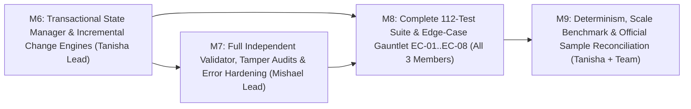

# 19 — Week 3 Implementation Plan (Handover Specification)

**Document Status:** Self-Contained Implementation Handover — **DO NOT EXECUTE UNTIL WEEK 2 COMPLETION**  
**Week 3 Implementation Coordinator:** **Tanisha Chhetri (`2462160`)**  
**Contributing Engineers:** Tanisha Chhetri (`2462160`), Steven Mathew Binu (`2462157`), Mishael Julian (`2462184`)  
**Target Outcome:** Complete transactional incremental change engine (`FR-05`: `BR-09`, `BR-10`, `BR-11`), tamper-proof independent validation (`ALG-18`) and cryptographic blast-radius verification (`ALG-19`), 112/112 automated tests green (`EC-01`–`EC-08`), `< 5.0 s` performance at expected scale, and official sample dataset verification.

---

## 1. Self-Contained Context for Week 3 Setup

Starting from Week 2's tagged baseline (`v0.2.0-week2-complete`), any developer can execute Week 3 directly using:
1. [`11_INCREMENTAL_RECOMPUTATION.md`](11_INCREMENTAL_RECOMPUTATION.md) — Dependency DAG, blast-radius isolation, fixed workload accounting, and 8-stage transactional lifecycle.
2. [`09_ALGORITHM_DESIGN.md`](09_ALGORITHM_DESIGN.md) — Exact pseudocode for `ALG-15` (`POSTPONE_COURSE`), `ALG-16` (`MARK_HALL_UNAVAILABLE`), `ALG-17` (`ADD_LATE_REGISTRANT`), `ALG-18` (full audit), and `ALG-19` (snapshots & SHA-256 session digests).
3. [`14_TEST_CASE_CATALOGUE.md`](14_TEST_CASE_CATALOGUE.md) — Remaining 50 edge-case, incremental, determinism, and scale tests.

*(Note: If the team adopts the optional rebalancing proposal in [`12_MODULE_OWNERSHIP.md`](12_MODULE_OWNERSHIP.md), Steven co-implements `postponement.py` and Mishael co-implements `state_manager.py` under Tanisha's coordination.)*

---

## 2. Week 3 Milestone Pipeline (`M6` -> `M7` -> `M8` -> `M9`)

---

## 3. Detailed Milestone Specifications (`M6` – `M9`)

### Milestone M6 — Transactional Incremental Change Management
- **Objective:** Implement copy-on-write candidate snapshots, SHA-256 session fingerprinting, `POSTPONE_COURSE` (`ALG-15`), `MARK_HALL_UNAVAILABLE` (`ALG-16`), and `ADD_LATE_REGISTRANT` (`ALG-17`), integrated into `orchestrator.py` and `cli.py` (`--commands`, `--resume-state`).
- **Responsible Owner:** **Tanisha Chhetri (`2462160`)** *(with optional co-implementation support from Steven on `ALG-15` and Mishael on `ALG-19` per `12_MODULE_OWNERSHIP.md`)*.
- **Dependencies:** Week 2 `M5` (`v0.2.0-week2-complete`).
- **Files Created / Modified:**
  - *Create:* `src/exam_engine/changes/__init__.py`, `policies.py`, `state_manager.py` (`ALG-19`), `postponement.py` (`ALG-15`), `hall_unavailability.py` (`ALG-16`), `late_registration.py` (`ALG-17`)
  - *Modify:* `src/exam_engine/io/parsers.py` (`commands.json` + `schedule_state.json` loader), `src/exam_engine/orchestrator.py` (sequential command loop), `src/exam_engine/cli.py` (`--commands`, `--resume-state`), `src/exam_engine/reporting/json_reporters.py` (`change_results.json`)
  - *Create Tests:* `tests/unit/test_postponement.py`, `tests/unit/test_hall_unavailability.py`, `tests/unit/test_late_registration.py`, `tests/integration/test_incremental_rollback.py`
- **Relevant Business Rules:** `FR-05`, `BR-09`, `BR-10`, `BR-11`, `BR-01`–`BR-08`, `BR-12`; `EC-06`; `AS-025`–`AS-031`.
- **Implementation Requirements:**
  1. **Blast-Radius Strictness:**
     - `POSTPONE_COURSE`: Recompute **only** `{S_orig, S_dest}`; verify removing course from `S_orig` does not strand a `< 10` partner; validate `BR-01` daily limits against fixed courses (`EC-06`).
     - `MARK_HALL_UNAVAILABLE`: No-op on allocations if hall unoccupied; else repack `S_orig` into next largest free hall(s); if insufficient capacity, iteratively displace smallest course `(enrolment_count, credits, course_code)` to next free session `> S_orig` and flag `COURSE_DISPLACED_BY_HALL_CLOSURE`.
     - `ADD_LATE_REGISTRANT`: Atomic across all courses in command (`AS-030`); reject any clash with `REJECTED_CLASH` + 2 sorted conflicting `course_code`s; select eligible hall with `(-free_legal_seats, hall_id)`; re-seat only that course's column set in that single hall; apply minimal delta invigilation (`AS-029`, including `EC-05` `+20m` overlap swap if newly SN).
  2. **Cross-Session Fixed Workload:** Always initialise `WorkloadTracker.from_fixed_sessions(cand, exclude=affected)` so fixed invigilation duties on later dates in the same ISO week are respected (`TC-097`).
  3. **Atomic Rollback & Hash Proof:** Assert `D_before[s] == D_after[s]` for every `s not in affected_sessions` before promoting `candidate_state`; discard `candidate_state` completely on any `REJECTED_*` outcome.
- **Required Tests:** `TC-071`–`TC-084`, `TC-091`–`TC-098`, `TC-112` (23 tests).
- **Acceptance Criteria & DoD:** Chained 8-command test (`TC-098`) verifies `unaffected_sessions_verified == True` on every applied step and bit-for-bit state preservation on every rejected step.
- **Git Commit Boundaries:**
  1. `feat(changes): implement ALG-19 StateSnapshotManager with SHA-256 session digest verification`
  2. `feat(changes): implement ALG-15 course postponement engine (BR-09, EC-06)`
  3. `feat(changes): implement ALG-16 hall unavailability recovery and smallest-course displacement (BR-10)`
  4. `feat(changes): implement ALG-17 atomic late student registration and delta staffing (BR-11)`
  5. `feat(app): wire sequential command execution, --resume-state, and change_results.json into CLI`
  6. `test(changes): add unit and rollback integration tests TC-071..084, TC-091..098, TC-112`
- **Handover to M7/M8:** Working batch + incremental CLI engine.

---

### Milestone M7 — Full Independent Validation & Tamper-Detection Hardening
- **Objective:** Complete all audit checks in `IndependentScheduleValidator` (`ALG-18`), add negative tamper-injection tests proving `ALG-18` catches any rule violation, and harden CLI exit-code and error messages.
- **Responsible Owner:** **Mishael Julian (`2462184`)**.
- **Dependencies:** `M6` (can develop tamper tests in parallel with `M6`).
- **Files Modified / Created:**
  - *Modify:* `src/exam_engine/validation/validator.py`, `src/exam_engine/cli.py`
  - *Create Tests:* `tests/unit/test_independent_validator.py`
- **Relevant Business Rules:** All `BR-01`–`BR-12`, `CN-07`–`CN-28`.
- **Implementation Requirements:**
  - Verify `validation/validator.py` has **zero imports** from `scheduling/`, `allocation/`, `invigilation/`, or `changes/`.
  - Audit every seat coordinate (`|c1 - c2| != 1` for same course), ground-floor Row 1 SN invariant, `+20m` windows, `< 10` cross-dept merge, `2h`/`3h` separation, 90% session cap, closed-hall absence, invigilator dept/availability/daily/ISO-weekly caps, and 1-to-1 correspondence between actual soft gaps / `UNSTAFFED` slots and `active_violations`.
- **Required Tests:** `TC-103`, `TC-104`, `TC-105` (tamper-injection suite).
- **Acceptance Criteria & DoD:** Deliberately mutating any single hard invariant in memory triggers `ScheduleIntegrityError` (`100%` branch coverage on `validator.py`).
- **Git Commit Boundaries:**
  1. `feat(validation): complete full BR-01..BR-12 independent audit and violation cross-checks`
  2. `test(validation): add tamper-injection negative audit suite TC-103..105`

---

### Milestone M8 — Complete Business-Rule & Mandatory Edge-Case Testing (`EC-01`–`EC-08`)
- **Objective:** Implement all remaining boundary, infeasible-dataset, and multi-rule interaction tests across `TC-001`–`TC-112`, plus `syn_02_edge_gauntlet/` and `syn_03_infeasible_stress/` synthetic bundles.
- **Responsible Owner:** **All 3 Members** coordinated by **Tanisha Chhetri** (Steven: scheduling/supplementary edge cases; Tanisha: merge/accessibility/change edge cases; Mishael: staffing/generative property tests).
- **Dependencies:** `M6`, `M7`.
- **Files Created:**
  - `data/synthetic/syn_02_edge_gauntlet/*`, `data/synthetic/syn_03_infeasible_stress/*`
  - `tests/unit/test_edge_cases_ec01_ec08.py`
  - `tests/integration/test_invariants.py` (`TC-110` seeded generative property suite)
- **Relevant Business Rules:** `EC-01`–`EC-08`, `BR-01`–`BR-12`.
- **Required Tests:** `TC-013`, `TC-017`–`TC-019`, `TC-024`, `TC-037`–`TC-040`, `TC-043`, `TC-045`, `TC-048`–`TC-050`, `TC-059`, `TC-064`, `TC-068`, `TC-069`, `TC-087`–`TC-090`, `TC-110` (brings cumulative suite to **109 / 112** tests before `M9`).
- **Acceptance Criteria & DoD:** Every single `EC-01`–`EC-08` has dedicated passing automated tests; seeded invariant fuzzer passes 25/25 topologies.
- **Git Commit Boundaries:**
  1. `test(scheduling): add infeasible, cross-cohort gap, and EC-08 supplementary edge tests`
  2. `test(allocation): add zero-partner small merge, 1-col hall, and accessible seat exhaustion tests`
  3. `test(invigilation): add chief pool exhaustion, extended building window, and EC-05 buffer policy tests`
  4. `test(property): add syn_02/syn_03 datasets and TC-110 25-seed invariant verification suite`

---

### Milestone M9 — Determinism, Performance & Official Expected-Output Verification
- **Objective:** Verify cross-process `PYTHONHASHSEED` determinism (`TC-108`), CSV row-permutation invariance (`TC-109`), full expected-scale performance `< 5.0 s` (`TC-111`), adapt `io/` & `reporting/` if official sample dataset has been released, verify golden outputs, update `README.md`, and run team mock viva.
- **Responsible Owner:** Coordinated by **Tanisha Chhetri**; `io/`/`reporting/` alignment & perf benchmark by **Mishael Julian**; permutation & golden regression tests by **Steven Mathew Binu**.
- **Dependencies:** `M8`.
- **Files Created / Modified:**
  - `data/synthetic/syn_04_full_scale_120c_2500s/*`
  - `data/sample/*` *(populated ONLY when official sample files are provided by mentors)*
  - `tests/regression/test_determinism.py` (`TC-108`, `TC-109`)
  - `tests/regression/test_performance.py` (`TC-111`)
  - `tests/regression/test_official_sample.py` *(enabled once official sample dataset arrives)*
  - `README.md` *(updated with exact CLI usage commands and test execution instructions)*
- **Implementation Requirements:**
  - Reconcile any schema header differences in `io/parsers.py` and `reporting/` (`RSK-001`) and verify provisional assumption flags (`AS-001`–`AS-033`) against official expected outputs (`RSK-002`).
  - Confirm `git log --shortlog` shows balanced, meaningful commits from Steven, Tanisha, and Mishael.
- **Required Tests:** `TC-108`, `TC-109`, `TC-111` (**112 / 112** design test cases complete) + official sample golden diff tests.
- **Acceptance Criteria & Final Capstone Definition of Done:**
  - `pytest` passes 112+ tests in `< 8 s` total; coverage $\ge 92\%$.
  - Full scale (`120` courses, `2,500` students, `18` halls, `90` invigilators, `12` days, `8` commands) runs in `< 5.0 s` (`~0.35 s` expected).
  - Subprocess runs with different `PYTHONHASHSEED` values produce identical SHA-256 output digests.
  - All 3 teammates complete live-code-modification drills from [`20_VIVA_PREPARATION.md`](20_VIVA_PREPARATION.md).
- **Git Commit Boundaries:**
  1. `test(regression): add PYTHONHASHSEED determinism, CSV permutation, and 120-course scale benchmarks`
  2. `feat(adapters): align IO/reporting adapters with official sample schema (when released)`
  3. `docs(readme): finalise CLI manual, architecture links, and verification instructions`
- **Final Release Tag:** `v1.0.0-final-submission`.
