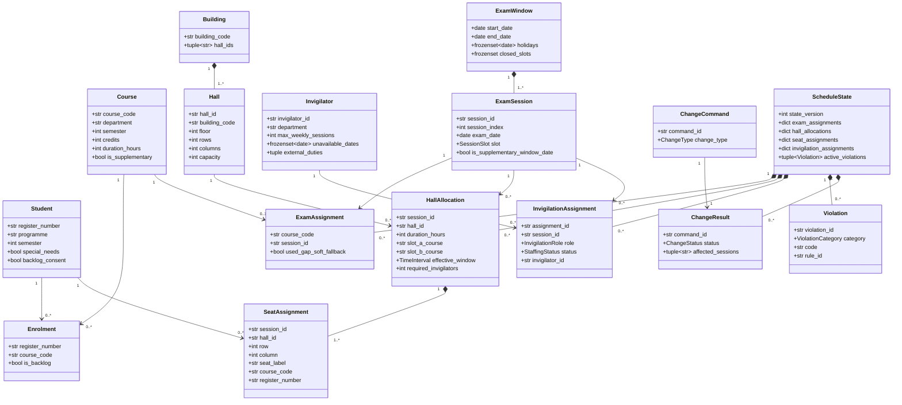
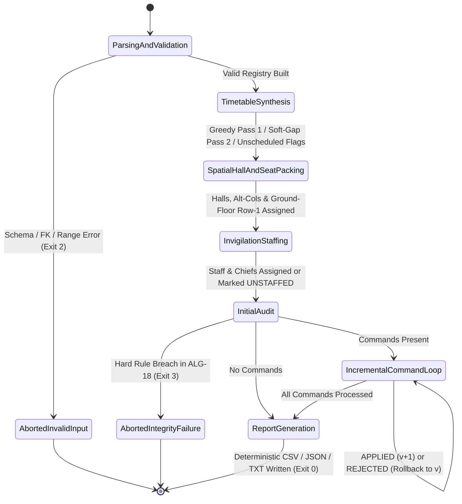

# University Exam Timetabling and Hall Allocation Engine (`AI-040-PS-067`)
## Consolidated Week 1 Software Architecture & Technical Design Document

| Metadata Field | Specification |
| :--- | :--- |
| **Problem Statement** | `PS-067` — University Exam Timetabling and Hall Allocation Engine (High Difficulty) |
| **Team ID & Repository** | `AI-040` — [`https://github.com/stevezone17-ops/AI-040-PS-067`](https://github.com/stevezone17-ops/AI-040-PS-067) |
| **Institution & Section** | CHRIST University — `6BTCSAIML A` (Capstone Provider: `10 SECONDS`) |
| **Team Members** | Steven Mathew Binu (`2462157`), Tanisha Chhetri (`2462160`), Mishael Julian (`2462184`) |
| **Milestone Phase** | **Week 1 — Understand and Design** *(Pending Team Confirmation & Required Mentor Approval)* |
| **Proposed Runtime** | Python 3.10+ Standard Library (`pytest` & `ruff` dev tools — *Pending Team Confirmation*) |

---

## 1. Executive Problem Summary & System Scope

University examination cells schedule hundreds of end-semester examinations across dated Morning (`FN: 09:30–12:30`) and Afternoon (`AN: 14:00–17:00`) sessions under tightly coupled temporal, spatial, accessibility, and human-resource constraints. Our system is a **deterministic, command-file-driven CLI backend engine** (no GUI, no web framework, no external database, no ML) engineered to:

1. **Validate & Normalise Master Registries (`FR-01`):** Courses (`2h`/`3h`), students, canonical enrolments, halls (capacity, grid dimensions, building, floor), and invigilators (`4–8` weekly limit, unavailable dates, external duties).
2. **Synthesise Conflict-Free Timetables (`FR-02`):** Enforce student clash rules (`BR-01`), core-course study gaps (`BR-02`), deterministic ordering with soft-gap fallback (`BR-03`), aggregate 90% session caps (`BR-04`), and final-3-day supplementary windows (`BR-12`).
3. **Allocate Halls & Individual Seats (`FR-03`):** Enforce duration homogeneity (`BR-04`), largest-hall-first packing, max 2 courses/hall, alternate-column seating, `< 10` cross-department merges (`BR-05`), and ground-floor Row 1 + 20-minute extensions for special-needs students (`BR-06`).
4. **Staff Invigilators & Building Chiefs (`FR-04`):** Assign `ceil(n/30)` department-independent hall invigilators + `1` chief per active building (`BR-07`) in deterministic workload order (`BR-08`), explicitly reporting `UNSTAFFED` shortages.
5. **Process Transactional Incremental Changes (`FR-05`):** Execute course postponements (`BR-09`), hall closures (`BR-10`), and late registrations (`BR-11`) while isolating recomputation strictly to affected sessions.
6. **Emit Deterministic Artefacts (`FR-06`):** Produce byte-reproducible `timetable.csv`, `hall_plan.csv`, `seat_assignments.csv`, `seat_maps.txt`, `invigilation_roster.csv`, `violations.json`, `change_results.json`, and `schedule_state.json`.

*(Full requirements and traceability: [`02_SOFTWARE_REQUIREMENTS_SPECIFICATION.md`](02_SOFTWARE_REQUIREMENTS_SPECIFICATION.md), [`15_REQUIREMENTS_TRACEABILITY_MATRIX.md`](15_REQUIREMENTS_TRACEABILITY_MATRIX.md).)*

---

## 2. Mandatory Domain Glossary

| Domain Term | Canonical Definition |
| :--- | :--- |
| **Active Building** | A campus building with $\ge 1$ occupied hall in a session; requires 1 additional `BUILDING_CHIEF` (`BR-07`). |
| **Affected Sessions (Blast Radius)** | Minimal set of `session_id`s recomputed by an incremental `ChangeCommand`; all other sessions remain frozen (`NFR-03`). |
| **Alternate-Column Seating** | Odd Column Set A (`1, 3, 5...`) and Even Column Set B (`2, 4, 6...`) preventing horizontally adjacent same-course examinees (`BR-05`). |
| **Backlog Consent (`BACKLOG_CONSENT`)** | Student flag allowing 2 exams on one date iff in distinct `{FN, AN}` sessions and $\ge 1$ is a backlog enrolment (`BR-01`, `AS-013`). |
| **Core vs. Elective Course** | Core: `credits >= 4` (requires $\ge 1$ full calendar day gap, `\|d2 - d1\| >= 2`, holidays counted); Elective: `credits < 4` (no gap) (`BR-02`). |
| **Effective Hall End Time** | `session_start + duration_hours` plus `+20` minutes when $\ge 1$ `special_needs` student sits in that hall (`BR-06`, `EC-05`). |
| **Resource Shortage (`UNSTAFFED`)** | Reportable state when eligible invigilators are exhausted (`BR-08`); never permits assigning an ineligible invigilator. |
| **Small Course** | Course with `1 <= enrolment_count < 10` (`EC-02`); must share a hall with an equal-duration course from a different department (`BR-05`). |
| **Soft Violation (`SOFT_VIOLATION`)** | Permitted fallback (`CORE_GAP_SOFT_VIOLATION`) used solely when no hard-valid session satisfies `BR-02` (`BR-03`). |
| **Supplementary Examination** | Dedicated backlog paper (`is_supplementary=True`) restricted to the final 3 active exam days (`AN`, or `FN`/`AN` if `> 50` students, `BR-12`). |

*(Complete 34-term glossary: [`03_DOMAIN_GLOSSARY.md`](03_DOMAIN_GLOSSARY.md).)*

---

## 3. Mandatory Business-Rule & Edge-Case Register Summary

| ID | Rule Title | Type | Authoritative Invariant & Failure Handling |
| :--- | :--- | :--- | :--- |
| **BR-01** | Student Clashes | Hard | Max 1 exam/session; max 1 exam/day unless `BACKLOG_CONSENT` + `{FN, AN}` + backlog paper (`AS-013`). |
| **BR-02** | Core Exam Gap | Soft-Fallback | Same cohort core exams (`credits >= 4`) need `\|d2 - d1\| >= 2` days; holidays count (`EC-01`). |
| **BR-03** | Greedy Heuristic | Policy | Sort `(-enrolment, -credits, course_code)`; Pass 1 (`Hard + Gap`), Pass 2 (`Hard + SOFT_VIOLATION`), else `UNSCHEDULED`. |
| **BR-04** | Capacity & Duration | Hard | Session students $\le (90 \times \sum \text{cap}) // 100$ (`EC-03`); `2h` and `3h` exams never share a hall. |
| **BR-05** | Hall Filling | Hard + Policy | Fill `(-capacity, hall_id)` first; $\le 2$ courses/hall; non-adjacent columns; `< 10` students must merge cross-dept (`EC-02`). |
| **BR-06** | Seating & Access | Hard + Policy | Row-major `R{r:02d}C{c:02d}`; alphabetical in alt cols; `special_needs` in `floor==0, row==1` + `20m` hall extension (`EC-05`). |
| **BR-07** | Invigilation Limits | Hard | `max(1, ceil(n/30))` per hall + `1` chief/active building; no own-dept in hall (`EC-04`); $\le 2$/day; `4..8`/ISO-week. |
| **BR-08** | Invigilator Sort | Policy + Shortage | Sort `(assigned_so_far, department, invigilator_id)`; respect unavailable/overlapping duties; mark shortages `UNSTAFFED`. |
| **BR-09** | Postponement | Incremental | Move to earliest feasible session `> S_orig`; validate daily caps (`EC-06`); regenerate **only** `{S_orig, S_dest}`. |
| **BR-10** | Hall Unavailability | Incremental | Move students to next largest free hall in `S_orig`; else displace smallest course `(enrol, credits, code)` to next free session. |
| **BR-11** | Late Registration | Incremental | Atomic across basket; clash -> `REJECTED_CLASH` (2 course codes); else seat in eligible hall with most free seats + delta staff. |
| **BR-12** | Supplementary | Hard | Final 3 active exam days (`AS-015`): `AN` only for `<= 50` students; `FN` or `AN` for `> 50` students (`EC-08`). |

*(Full register, 8 mandatory edge cases `EC-01`–`EC-08`, and 33 structured assumptions `AS-001`–`AS-033`: [`04_BUSINESS_RULE_REGISTER.md`](04_BUSINESS_RULE_REGISTER.md), [`05_ASSUMPTION_REGISTER.md`](05_ASSUMPTION_REGISTER.md), [`06_CONSTRAINT_CATALOGUE.md`](06_CONSTRAINT_CATALOGUE.md).)*

---

## 4. Layered System Architecture

The application comprises **14 modular components** across **5 unidirectional layers** (`src/exam_engine/`):
1. **Interface Layer:** `cli.py` (13), `orchestrator.py` (14).
2. **Adapter Layer:** `io/` Input Parsing & Validation (02), `reporting/` Deterministic Report Generation (12).
3. **Workflow, State & Audit Layer:** `changes/` Change Management Engine (09), `state_manager.py` Schedule State & Snapshot Manager (11), `validation/validator.py` Independent Schedule Validator (10 — imports *only* `domain/`).
4. **Constructive Domain Engines:** `scheduling/scheduler.py` (03), `conflict_graph.py` & `gap_validator.py` (04), `allocation/hall_allocator.py` (05), `seat_assigner.py` (06), `accessibility.py` (07), `invigilation/` (08).
5. **Pure Domain Kernel:** `domain/` Immutable Entities, Enums, Protocols & `ScheduleState` (01).

Key architectural Coupling Insight (`ADR-008`): During `ALG-06` greedy course scheduling, every candidate session check invokes `ALG-08` (`HallPackabilityChecker`) to confirm concrete 2D hall, duration, merge, and ground-floor Row 1 packability—preventing downstream spatial failures while strictly preserving `BR-03` ordering.

*(Detailed component specs & 20 algorithms `ALG-01`–`ALG-20`: [`07_SYSTEM_ARCHITECTURE.md`](07_SYSTEM_ARCHITECTURE.md), [`09_ALGORITHM_DESIGN.md`](09_ALGORITHM_DESIGN.md).)*

---

## 5. Mandatory Domain Model & UML Class Diagram

`Enrolment(register_number, course_code, is_backlog)` serves as the **single source of truth** for student-course membership; `ProblemRegistry` exposes immutable sorted views without duplicating mutable lists across `Student` and `Course`.

*(Full 16-entity attribute & invariant specification: [`08_DOMAIN_MODEL.md`](08_DOMAIN_MODEL.md).)*

---

## 6. Mandatory Scheduling & Transactional State Diagrams

### 6.1 End-to-End Engine Lifecycle State Diagram

### 6.2 Incremental Recomputation & Blast-Radius Guarantee (`FR-05`)
Every `ChangeCommand` clones `ScheduleState` ($\mathcal{O}(M)$ copy-on-write over frozen per-session tuples), pre-loads fixed invigilator duties from all unaffected sessions into `WorkloadTracker`, recomputes **only** `affected_sessions`, validates global hard invariants via `ALG-18`, and verifies **SHA-256 session digest equality** across all unaffected sessions before atomic commit—or discards the candidate state on any `REJECTED_*` failure.

*(Full incremental protocol & all 12 diagrams: [`11_INCREMENTAL_RECOMPUTATION.md`](11_INCREMENTAL_RECOMPUTATION.md), [`diagrams/README.md`](diagrams/README.md).)*

---

## 7. Provisional I/O Contracts & Verification Summary

- **Provisional Inputs (`io/`):** `courses.csv`, `students.csv`, `enrolments.csv`, `halls.csv`, `invigilators.csv`, `exam_window.json`, `commands.json` — isolated behind adapter interfaces (`NFR-06`, [`10_INPUT_OUTPUT_CONTRACTS.md`](10_INPUT_OUTPUT_CONTRACTS.md)).
- **Deterministic Outputs (`reporting/`):** `timetable.csv`, `hall_plan.csv`, `seat_assignments.csv`, `seat_maps.txt`, `invigilation_roster.csv`, `violations.json`, `change_results.json`, `schedule_state.json`.
- **Verification Coverage:** **112 design-level test cases (`TC-001`–`TC-112`)** across unit, integration, seeded invariant, `PYTHONHASHSEED` determinism, and `120`-course / `2,500`-student scale benchmarks (`< 5.0 s` target, `~0.35 s` expected). See [`13_TEST_STRATEGY.md`](13_TEST_STRATEGY.md) and [`14_TEST_CASE_CATALOGUE.md`](14_TEST_CASE_CATALOGUE.md).

---

## 8. Mandatory Module Ownership & Implementation Handover Summary

*Status: Proposed — Pending Team Confirmation. All three members contribute production code, tests, and Git commits in Weeks 2 and 3.*

| Team Member | Reg. No. | Leadership Role | Owned Subsystems & Business Rules |
| :--- | :--- | :--- | :--- |
| **Mishael Julian** | `2462184` | Architecture, Validation & Integration Lead (Week 1 Lead) | `domain/` (lead), `io/` (`ALG-01`), `invigilation/` (`BR-07`, `BR-08`, `ALG-13`–`14`), `validation/` (`ALG-18`), `reporting/` (`ALG-20`), `orchestrator.py`, `cli.py`, integration/determinism tests (`40` TCs). |
| **Steven Mathew Binu** | `2462157` | Week 2 Implementation Coordinator (`M1`–`M5`) | `scheduling/`: `session_generator` (`ALG-02`), `conflict_graph` (`BR-01`, `ALG-03`), `gap_validator` (`BR-02`, `ALG-04`), `ordering` & `scheduler` (`BR-03`, `BR-04` session cap, `ALG-05`–`06`), `supplementary` (`BR-12`, `ALG-07`) (`26` TCs; optional `ALG-15` co-ownership proposed). |
| **Tanisha Chhetri** | `2462160` | Week 3 Implementation Coordinator (`M6`–`M9`) | `allocation/`: `hall_allocator` & `merge_policy` (`BR-04` hall duration, `BR-05`, `ALG-08`–`10`), `seat_assigner` & `accessibility` (`BR-06`, `ALG-11`–`12`); `changes/`: `postponement`, `hall_unavailability`, `late_registration`, `state_manager` (`BR-09`–`11`, `ALG-15`–`17`, `19`) (`46` TCs). |

*(Detailed workload evaluation, ADRs, risks, and milestone handover plans: [`12_MODULE_OWNERSHIP.md`](12_MODULE_OWNERSHIP.md), [`16_DECISION_LOG.md`](16_DECISION_LOG.md), [`17_RISK_REGISTER.md`](17_RISK_REGISTER.md), [`18_WEEK_2_IMPLEMENTATION_PLAN.md`](18_WEEK_2_IMPLEMENTATION_PLAN.md), [`19_WEEK_3_IMPLEMENTATION_PLAN.md`](19_WEEK_3_IMPLEMENTATION_PLAN.md).)*
